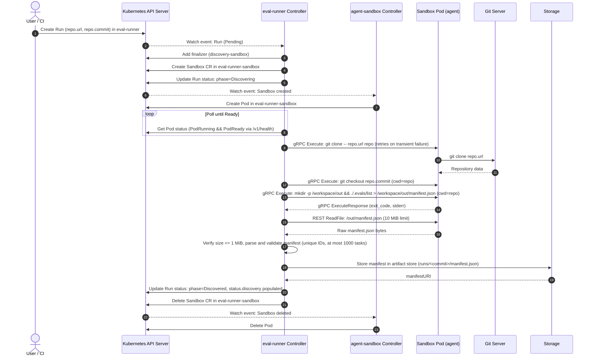

<!--
Copyright 2026 Google LLC

Licensed under the Apache License, Version 2.0 (the "License");
you may not use this file except in compliance with the License.
You may obtain a copy of the License at

    http://www.apache.org/licenses/LICENSE-2.0

Unless required by applicable law or agreed to in writing, software
distributed under the License is distributed on an "AS IS" BASIS,
WITHOUT WARRANTIES OR CONDITIONS OF ANY KIND, either express or implied.
See the License for the specific language governing permissions and
limitations under the License.
-->

# eval-runner Architecture

This document describes the architecture of `eval-runner` as implemented on `main` today.

Where [docs/concept/functionality.md](concept/functionality.md) describes the target product concept and end-state, this document records what is actually built and deployed today:
- Discovery of eval manifests in isolated, zero-privilege sandboxes via `.evals/list`
- Sample execution in isolated task sandboxes running Inspect (`inspect eval --limit a-b`)
- The `Run` custom resource representing an immutable commit $\times$ sample window
- The `Comparison` custom resource pairing candidate and baseline Runs
- Adaptive paired batch evaluation driven by statistical stopping rules (bootstrap percentile CIs on paired deltas, Rubin's Bayesian Bootstrap for P(improvement), tie-splitting, candidate-failure cap)
- GitHub PR integration (in-place comment updates and check runs via GitHub App or PAT auth)
- Automated webhook integration (`eval-runner-webhook`) handling `pull_request`, `push`, and `issue_comment` (`/eval more <n>`) events with baseline cache reuse and adaptive paired sampling
- Web dashboard UI (`eval-runner-ui`) serving Runs and Comparisons
- Zero-trust artifact persistence (`ArtifactSink`: GCS, local directory, or in-memory) for manifests, Inspect logs, summaries, and comparison tables

Future target functionality not yet started includes trajectory mining (§7), trajectory viewer UI (§6), fine-tune training loops (§8), cohorts (§9.2), and declared resources/image builds (§2.2/§3).

---

## 1. Components

The system consists of the following components running inside a Kubernetes cluster:

```
+-----------------------------------------------------------------------------------------+
| Kubernetes Cluster                                                                      |
|                                                                                         |
|  +-------------------------------------------+    +----------------------------------+  |
|  | Namespace: eval-runner                    |    | Namespace: eval-runner-sandbox   |  |
|  |                                           |    |                                  |  |
|  |  +-------------------------------------+  |    |  +----------------------------+  |  |
|  |  | Run & Comparison CRs                |  |    |  | Sandbox CRs                |  |  |
|  |  | (evalrunner.gke-labs.dev/v1alpha1)  |  |    |  | (agents.x-k8s.io/v1beta1)  |  |  |
|  |  +------------------+------------------+  |    |  +-------------+--------------+  |  |
|  |                     | watches/updates     |    |                | creates/deletes |  |
|  |  +------------------v------------------+  |    |  +-------------v--------------+  |  |
|  |  | eval-runner Controller              +--+--->+--+ Sandbox Pods (mTLS)        |  |  |
|  |  | (cmd/eval-runner)                   |  |gRPC|  | - Discovery (.evals/list)  |  |  |
|  |  +--------+------------------+---------+  |9090|  | - Task (inspect eval)      |  |  |
|  |           |                  |            |REST|  | - sandboxd runtime daemon  |  |  |
|  |  +--------v-------+  +-------v---------+  |8080|  | - automountToken: false    |  |  |
|  |  | Webhook Service|  | Web UI          |  |    |  | - runAsUser: 1000          |  |  |
|  |  | (cmd/webhook)  |  | (cmd/ui)        |  |    |  | - drop: [ALL]              |  |  |
|  |  +----------------+  +-----------------+  |    |  | - seccomp: RuntimeDefault  |  |  |
|  |                                           |    |  +----------------------------+  |  |
|  +--------------------+----------------------+    +----------------------------------+  |
|                       | writes artifacts                                                |
|                       v                                                                 |
|             +-------------------+                                                       |
|             | ArtifactSink      | (GCS / LocalDir / InMemory)                           |
|             +-------------------+                                                       |
+-----------------------------------------------------------------------------------------+
```

### The Controller (`cmd/eval-runner`)

The controller is written in Go and built with [controller-runtime](https://github.com/kubernetes-sigs/controller-runtime) (v0.25.2). Its entrypoint is `cmd/eval-runner/main.go`.

Key implementation details:
- **Dual reconcilers**: Reconciles `Run` custom resources (discovery and task sample execution) and `Comparison` custom resources (paired statistical evaluation, adaptive batch extension, and GitHub reporting).
- **Prerequisite validation**: On startup, before launching manager loops, the controller checks the Kubernetes API discovery client for the `Sandbox` resource in group `agents.x-k8s.io/v1beta1`. If the CRD is absent, it logs an error and exits immediately (`os.Exit(1)`).
- **Least-privilege caching**: The controller configures manager informers to cache only relevant objects in their specific namespaces:
  - `v1alpha1.Run` and `v1alpha1.Comparison` objects are cached solely in the controller namespace (`eval-runner`).
  - `sandboxv1beta1.Sandbox` and core `v1.Pod` objects are cached solely in the sandbox namespace (`eval-runner-sandbox`).
- **Health probes**: Exposes HTTP health endpoints on port `:8081` (`/healthz` and `/readyz`).
- **Pod execution**: Drives discovery and task execution through a typed client (`pkg/sandboxclient`) connecting directly to the sandbox pod IP over mutual TLS (mTLS): gRPC `ProcessService` on `:9090` and REST `FilesystemService` on `:8080`. Controller RBAC drops `pods/exec`.
- **Configurable limits**: Command-line flags `--max-stdout-bytes` (default: 1 MiB) and `--max-stderr-bytes` (default: 64 KiB) configure buffer caps for captured process streams; `--artifact-max-upload-bytes` (default: 10 MiB) caps artifact upload size.
- **Per-cluster configuration (`eval-runner-config` ConfigMap)**: Deployment-specific settings (such as `artifactBucket`, `discoveryDeadline`, `executionDeadline`, `maxParallelTasks`, default `modelSecret`, `sandboxdImage`, `uiBaseURL`, and GitHub secrets) are loaded from the `eval-runner-config` ConfigMap in the controller namespace (ADR-017, #70, #73, `pkg/configkeys`). Precedence order is explicit CLI flag > ConfigMap key > built-in default. Setting a key to the sentinel string `none` explicitly disables features or secrets without requiring flag modifications.

### The `Run` CRD (`evalrunner.gke-labs.dev/v1alpha1`)

The `Run` custom resource represents an evaluation execution against a specific commit of a git repository and a sample window:
- **Group/Version**: `evalrunner.gke-labs.dev/v1alpha1`
- **Kind**: `Run` (short name: `run`)
- **Scope**: Namespaced (`eval-runner`)
- **Specification (`spec`)**:
  - `repo.url`: The git clone URL for the repository under test.
  - `repo.commit`: The exact git commit SHA, strictly validated by regex `^[0-9a-fA-F]{7,64}$`. Branch and tag names are rejected by CRD validation.
  - `model`: Model identifier (e.g. `mockllm/model`, `google/gemini-2.5-flash`). When empty, the Run stops at `Discovered`.
  - `sampleRange`: Optional 1-based inclusive sample window (`{start, end}`) evaluating a slice of each task's dataset. Mutually exclusive with `limit`.
  - `limit`: Optional total sample count evaluating `1..limit`.
  - `tasks`: Optional allow-list of task IDs to run. If empty, all discovered eligible tasks run.
- **Status (`status`)**:
  - `phase`: Lifecycle phase: `Pending`, `Discovering`, `Discovered`, `Running`, `Completed`, or `Failed`. Terminal Runs are strictly immutable (ADR-025).
  - `message`: Human-readable status or bounded error description.
  - `conditions`: Kubernetes conditions, including condition `Discovered` (`True` or `False`).
  - `discovery`: Pointers, hash, and counts for the discovered manifest (`manifestPath`, `manifestHash`, `taskCount`, `eligibleTaskCount`, and up to 50 `taskIDs`).
  - `discoveryDeadline`: Overall deadline (`metav1.Time`) by which discovery must complete.
  - `executionDeadline`: Overall deadline (`metav1.Time`) by which sample execution must complete.
  - `tasks`: Per-task execution results (`TaskStatus`), including `phase` (`Pending`, `Running`, `Completed`, `Failed`), `samples`, `successes`, `meanScore`, `successRate`, `successRateCI` (95% Wilson score or Student's t-interval), `sampleRange`, `tokens` (`{input, output, total}`), `logPath`, and `message`.
  - `summary`: Aggregate statistics across tasks (`RunSummary`): `tasksCompleted`, `tasksFailed`, `tasksTotal`, `totalSamples`, `meanSuccessRate`, `successRateRange {min,max}`, and printer strings `tasks`/`rates`.
  - `artifacts`: Base URI or path prefix for stored artifacts (`runs/<commit>/`).
- **Finalizer**: `evalrunner.gke-labs.dev/discovery-sandbox` ensures discovery and task sandboxes in `eval-runner-sandbox` are cleaned up if a Run is deleted.

### The `Comparison` CRD (`evalrunner.gke-labs.dev/v1alpha1`)

The `Comparison` custom resource pairs two `Run` resources, evaluates statistical stopping rules, manages adaptive batch extension, and drives GitHub PR reporting (ADR-018, ADR-021, ADR-025, ADR-026):
- **Group/Version**: `evalrunner.gke-labs.dev/v1alpha1`
- **Kind**: `Comparison` (short name: `comp`)
- **Scope**: Namespaced (`eval-runner`)
- **Specification (`spec`)**:
  - `baseline.run`: Name of the baseline `Run` resource in the same namespace.
  - `candidate.run`: Name of the candidate (e.g. PR head) `Run` resource.
  - `equivalenceMargin`: Equivalence margin (default: 0.05 for $\pm 0.05$).
  - `sampling`: Optional adaptive batch configuration (`batchSize`, default 8; `maxSamplesPerTask`, default 64). When omitted, only the single pair of referenced Runs is compared.
  - `tasks`: Optional allow-list of task IDs to compare.
  - `extraSamples`: Optional request to evaluate $N$ additional samples beyond the stopping rule.
  - `pullRequest`: Optional GitHub PR target (`repository`, `number`, `headSHA`, `baseSHA`).
- **Status (`status`)**:
  - `phase`: Lifecycle phase: `Running` or `Completed`.
  - `verdict`: Aggregate run-level verdict: `IMPROVED`, `REGRESSED`, `UNCHANGED`, `INCONCLUSIVE`, or `RUNNING`.
  - `pImprovement`: Aggregate posterior probability of net improvement.
  - `tasks`: Per-task paired metrics (`ComparisonTaskStatus`): `baseRate`, `candidateRate`, `delta`, `deltaCI` (95% bootstrap percentile interval with normal-approximation fallback), `pairs`, `wins`, `losses`, `ties`, `dropped: {candidate, baseline}`, `label`, `decision`, `samplesRun`, `suggestedNext`, and `tokens`.
  - `batches`: List of completed and in-flight evaluation batch records (`ComparisonBatchStatus` structs with `index`, `sampleRange`, `candidateRun`, `baselineRun`, and `phase`).
  - `summaryPath`: Storage path or URI where `comparisons/<name>.json` was written to the artifact sink.
  - `message`: Human-readable summary of verdicts, task notes, or candidate-task failure caps.

### Webhook Service (`cmd/eval-runner-webhook`)

The `eval-runner-webhook` service (image `eval-runner-webhook`) receives GitHub webhooks for automated evaluation (ADR-023):
- **Signature verification**: Validates HMAC-SHA256 (`X-Hub-Signature-256`) against Secret `eval-runner/github-webhook` before JSON parsing.
- **Fail-closed allow-list**: Filters events against a configured repository allow-list.
- **Asynchronous bounded queue**: Decouples HTTP receipt from Kubernetes client operations using an in-memory bounded queue, responding to GitHub within 10 seconds.
- **Deterministic resource creation & cleanup**: On `pull_request` (opened, synchronize, reopened) and `push` events, creates candidate Run `pr-<num>-<headSHA7>`, baseline Run `base-<baseSHA7>`, and Comparison `pr-<num>`. Reuses existing Completed baseline Runs targeting the same commit and model across PRs. On `pull_request` (`closed`), deletes the PR's Comparison(s) (owned batch Runs are deleted via Kubernetes owner references) and seed candidate Runs (unless referenced by a surviving live Comparison), while preserving baseline Runs for cache reuse across PRs; if reopened, resources are recreated on the next `pull_request` event. Note that artifacts in the artifact sink (GCS/local) are not purged by PR closure or TTL.

### Web Dashboard UI (`cmd/eval-runner-ui`)

The `eval-runner-ui` service (image `eval-runner-ui`) serves an HTML web dashboard:
- `GET /runs`: Overview of all Runs in the namespace with phase, task counts, sample ranges, and success rates.
- `GET /runs/{namespace}/{name}`: Detailed per-task breakdown for a single Run.
- `GET /comparisons`: Overview of all Comparisons with verdicts, $P(\text{improvement})$, and batch progress.
- `GET /comparisons/{namespace}/{name}`: Complete paired comparison table mirroring the PR comment layout.

### Two Namespaces

The system is deployed into two distinct namespaces:
1. `eval-runner`: Hosts the controller Deployment, webhook Deployment, UI Deployment, their ServiceAccounts, and user-submitted `Run` and `Comparison` custom resources.
2. `eval-runner-sandbox`: Hosts the untrusted `Sandbox` custom resources and their backing pods, plus fixture services during tests (e.g. `git-server`).

**Why they are separate:**
- **Workload isolation**: Sandboxes execute untrusted code checked out from arbitrary git repositories. Running them in a dedicated namespace prevents untrusted processes from interacting with controller resources or other system components.
- **Least-privilege RBAC**: The controller has distinct, namespaced permissions in each namespace (read/write `Run`s in `eval-runner`; create/delete `Sandbox`es and exec into pods in `eval-runner-sandbox`). Sandboxes themselves have no Kubernetes API access.
- **Informer scoping**: Restricts controller-runtime caches to only watch objects in the namespaces where they are expected.
- **Pod Security Admission (PSA)**: Both namespaces enforce the `restricted` PSA profile.

### Sandbox Primitive (`agent-sandbox`)

The controller relies on [kubernetes-sigs/agent-sandbox](https://github.com/kubernetes-sigs/agent-sandbox) (pinned release `v1.0.7`) as its sandbox abstraction.

The controller creates a `Sandbox` CR (`agents.x-k8s.io/v1beta1`) in `eval-runner-sandbox`. The name is deterministically derived as `discovery-<run-name>` (or a truncated name plus an 8-hex-character hash suffix if the name would exceed 63 characters). The `agent-sandbox` controller reconciles this CR and creates the underlying pod.

### Discovery Flow and State Machine

The reconciliation loop in `pkg/controller/run_controller.go` operates as a state machine:

```
[Create Run]
      |
      v
  (Pending) -------> Ensure finalizer
      |              Create Sandbox in eval-runner-sandbox
      v
(Discovering) -----> Wait for backing Pod Ready
      |              Drive step-based discovery via sandboxd (5m deadline)
      |                Step 1: git clone -- <url> repo (retry up to N times)
      |                Step 2: git checkout <commit> (no retry)
      |                Step 3: ./.evals/list (no retry, typed failures)
      |              Enforce stdout (1 MiB) & stderr (64 KiB) limits
      |              Validate manifest
      |
      +------------> Success: Delete Sandbox, phase = Discovered
      |
      +------------> Failure: Delete Sandbox, phase = Failed (bounded message)
```

1. **Pending -> Discovering**:
   - The controller ensures the finalizer `evalrunner.gke-labs.dev/discovery-sandbox` is added to the `Run`.
   - The controller builds and creates the `Sandbox` CR in `eval-runner-sandbox`.
   - The Run status phase is updated to `Discovering` with condition `Discovered=False` (reason `Discovering`) and `status.discoveryDeadline` is recorded (default 10 minutes, configurable via `--discovery-deadline`).
2. **Waiting for Pod Ready**:
   - The controller watches both Sandbox and Pod resources in `eval-runner-sandbox`. The backing pod name is resolved via the `agents.x-k8s.io/pod-name` annotation with fallback to the sandbox name.
   - The overall discovery deadline check runs before checking whether the pod exists; if expired, the Run is failed immediately and the sandbox is cleaned up.
   - If the pod is not yet ready, the controller requeues after `min(2s, remaining deadline)`.
   - If the pod enters `PodFailed` or `PodSucceeded` unexpectedly, or if the Sandbox condition `Finished=True`, the Run transitions to `Failed`.
   - Readiness is satisfied via the Sandbox `Ready` condition OR backing pod readiness (which reflects sandboxd's `/v1/health` HTTP probe).
3. **Execution as Discrete Steps**:
   - Once the pod is ready, the controller dials the pod IP directly on `:9090` using `pkg/sandboxclient` and executes discovery through discrete steps:
     - **Step 1 (`git clone`)**: `git clone -- <url> repo`. If the clone exits non-zero, it retries up to N times (default: 5, configured via `--max-discovery-attempts`) with backoff (5s, 10s, 20s, 40s), cleaning up any partial directory before retrying. All attempts are bounded by the discovery deadline. If all attempts are exhausted, the Run fails and the attempt count is recorded in `status.message`.
     - **Step 2 (`git checkout`)**: `git checkout <commit>` with working directory `repo`. If checkout exits non-zero, the Run fails immediately without retry (commit not found is permanent).
     - **Step 3 (`./.evals/list` to file)**: Executes `sh -c "mkdir -p /workspace/out && ./.evals/list > /workspace/out/manifest.json"` inside `repo` without retries. Outcomes are typed into distinct failure messages:
       - Missing executable (`codes.NotFound` / not found)
       - Non-executable permissions (`codes.PermissionDenied` / permission denied)
       - Non-zero exit code
       - Output limit exceeded
       - Invalid JSON
   - **Timeout**: The per-step execution context timeout is derived from the remaining discovery deadline budget (capped at `5*time.Minute`).
4. **Manifest Retrieval and Limits**:
   - The controller pulls the written manifest file via sandboxd REST `ReadFile` (`/out/manifest.json`).
   - Sandboxd resolves paths relative to `--root-dir=/workspace`, mapping `/out/manifest.json` directly to `/workspace/out/manifest.json`.
   - The read is bounded by the sandboxclient read limit (10 MiB) and checked controller-side against the 1 MiB manifest size cap (`MaxManifestBytes`).
5. **Manifest Parsing, Validation, and Storage**:
   - The manifest bytes are parsed into a JSON `Manifest` (`pkg/discovery/manifest.go`).
   - Validation enforces:
     - Manifest must not be nil.
     - `tasks` list must not be empty.
     - `tasks` count must not exceed 1,000 (`MaxTasks`).
     - Each task must have a non-empty, unique `id`.
     - Each task must have a non-empty `spec`.
   - The raw manifest JSON is persisted to the configured `ArtifactSink` under `runs/<commit>/manifest.json` with metadata.
   - The parsed manifest is cached in the controller's per-Run in-memory cache.
6. **Completion**:
   - **On Success**: `status.phase` is set to `Discovered` (or `Running` if `spec.model` is set), condition `Discovered=True` is recorded (recording attempt count if retried), `status.discovery` is populated (`manifestPath`, `manifestHash`, `taskCount`, `eligibleTaskCount`, and up to 50 `taskIDs`), and the discovery sandbox CR is deleted.
   - **On Failure**: `status.phase` is set to `Failed`, condition `Discovered=False` (reason `DiscoveryFailed`) is recorded, `status.message` is populated with the failed step name, attempt count, error description, pod phase, container waiting reasons/messages (e.g. `ImagePullBackOff`, `ErrImagePull`, `CreateContainerConfigError`), and `PodScheduled=False` reason for unschedulable pods, appended to any bounded stderr tail (up to 10 lines / 3 KiB; total message bounded to 4 KiB), and the sandbox CR is deleted.

### Finalizer-Based Cleanup

Kubernetes `ownerReferences` cannot cross namespace boundaries: a `Run` in `eval-runner` cannot be an owner reference for a `Sandbox` in `eval-runner-sandbox`.

To prevent orphaned sandboxes:
- The controller adds `evalrunner.gke-labs.dev/discovery-sandbox` to the `Run` before creating the sandbox.
- When a `Run` has a deletion timestamp, the controller locates the sandbox matching `evalrunner.gke-labs.dev/run-name` and `evalrunner.gke-labs.dev/run-namespace`, deletes it, removes the finalizer, and updates the Run.
- When a terminal Run (`Discovered` or `Failed`) is reconciled, any lingering sandbox matching the Run is cleaned up.

### Zero-Privilege Sandbox Specification

The discovery sandbox pod implements deployment topology B and concept §3.2 ("empty resources = zero privilege"):
- **InitContainer injection (Topology B)**: `install-sandboxd` initContainer copies `/usr/local/bin/sandboxd` from the pinned image `us-central1-docker.pkg.dev/k8s-staging-images/agent-sandbox/sandboxd:v20261015-v1.0.7` into a shared `/sandboxd-bin` emptyDir volume.
- **Agent Container**: Runs `alpine/git:v2.47.2` invoking `/sandboxd-bin/sandboxd --root-dir=/workspace --rest-port=8080 --grpc-port=9090`. All commands execute in the base image's rootfs where `git` is available.
- **Ports & Readiness**: Exposes port `:8080` (REST FilesystemService and health probe) and `:9090` (gRPC ProcessService). Readiness probe checks HTTP GET `/v1/health` on port `:8080`.
- **No ServiceAccount token**: `automountServiceAccountToken: false`. No token volume is projected.
- **Non-root**: `runAsNonRoot: true`, `runAsUser: 1000`, `runAsGroup: 1000`, `fsGroup: 1000`.
- **No privilege escalation**: `allowPrivilegeEscalation: false`.
- **Capabilities**: All Linux capabilities dropped (`drop: ["ALL"]`).
- **Seccomp**: `seccompProfile.type: RuntimeDefault`.
- **Pod Security Admission**: `eval-runner-sandbox` namespace is labeled with `pod-security.kubernetes.io/{enforce,warn,audit}: restricted`.
- **Resource requests and limits**: Requests 100m CPU / 128Mi RAM; limits 500m CPU / 512Mi RAM.

### Task Sample Execution Flow

When a `Run` specifies `spec.model`, after discovery completes, the controller executes eval tasks inside sandboxes (ADR-016, ADR-025):
- **One sandbox per task**: Each task executes in its own dedicated sandbox running `inspect eval --limit a-b` (evaluating a window specified by `spec.sampleRange`), **not one pod per sample**. The sandbox pod is reclaimed as soon as the task completes.
- **Model Credentials**: If configured, the controller mounts optional model API keys from Secret `eval-runner-sandbox/model-credentials` into the sandbox container (ADR-015).
- **Inspect Execution**: The sandbox executes `inspect eval <spec> --model <model> --limit <start>-<end>` (or `1..limit`) and writes output logs to `/workspace/out/<task-log>.json`.
- **Result Retrieval and Metrics**: The controller pulls the Inspect log via sandboxd REST `ReadFile`, parses sample scores, computes single-task success rate and 95% confidence intervals (Wilson score interval for binary scores, Student's t-interval for continuous scores), extracts token usage (`input`, `output`, `total`), writes the log and `summary.json` to the artifact sink, and updates `Run.status.tasks[]`.
- **Terminal Immutability**: When all tasks complete, `Run.status.phase` is set to `Completed` (or `Failed`). Once terminal, Runs are strictly immutable (ADR-025); new sample windows are evaluated by spawning fresh batch Runs.

### Adaptive Paired Batches and Comparison Flow

The `Comparison` reconciler pairs candidate and baseline Runs across batches (ADR-018, ADR-025, ADR-026):
- **Task Intersection**: The controller only compares tasks that were Completed by both candidate and baseline Runs (#133); unexecuted tasks or tasks attempted by only one side are surfaced in `status.message` and the comparison summary rather than being counted as inconclusive or skewing the verdict.
- **Sink-Based Sample Pairing**: Inspect logs for both candidate and baseline Runs are loaded from the artifact sink. Candidate and baseline samples are paired matching on stable Inspect `sample.id` extracted from Inspect logs (#131, ADR-018).
- **Stopping Rule Evaluation**: Per-task differences are evaluated using `pkg/stats.Decide`. Stopping rules require a minimum of $n \ge 8$ pairs (`MinPairsToDecide = 8`) before CI stopping rules can fire. If the 95% CI on Δ (bootstrap percentile interval by default, normal approximation as fallback) excludes zero, the task stops as `improved` or `regressed`; if the CI lies entirely within $\pm \text{equivalenceMargin}$, the task stops as `unchanged`; if `maxSamplesPerTask` is reached, it stops as `inconclusive`.
- **Batch Extension via Immutable Runs**: If any task remains undecided and under `maxSamplesPerTask`, the `Comparison` controller schedules new immutable Run pairs (`<comp>-b<k>-cand`, `<comp>-b<k>-base`) evaluating the next sample window (`[highestPosition + 1, nextEnd]`) for undecided tasks only. Existing Completed baseline Runs targeting the same commit and window are reused across PRs (ADR-023, ADR-026).
- **Verdict Aggregation and Capping**: Once all tasks reach a terminal stopping decision, run-level verdict and headline $P(\text{improvement})$ are aggregated with tie splitting (ADR-019). If a candidate task failed while the baseline completed (or was not planned), the failure caps any `UNCHANGED` or `IMPROVED` verdict to `INCONCLUSIVE` with $P(\text{improvement})$ capped at 0.50 (issue #141). The complete comparison table is written to `comparisons/<name>.json` in the artifact sink.

### Artifact Layout

All artifacts are persisted to the configured `ArtifactSink` (Google Cloud Storage, local directory in Kind, or in-memory) under a deterministic layout (ADR-018, ADR-022, ADR-025, ADR-026):
- `runs/<commit>/manifest.json`: Discovered task manifest produced by `.evals/list`.
- `runs/<commit>/<task>/<inspect-log>.json`: Full Inspect evaluation log containing sample outputs and trajectories.
- `runs/<commit>/<task>/summary.json`: Task execution summary with sample window, scores, and token breakdown.
- `comparisons/<name>.json`: Complete paired comparison table, per-task deltas, confidence intervals, aggregate verdict, and full lists of skipped, unexecuted, and candidate-failed task IDs.

### GitHub Reporting and Check Run State Mapping

When `spec.pullRequest` is configured on a `Comparison`, the controller reports results directly to GitHub (ADR-021, ADR-024):
- **Single Updating PR Comment**: Formatted via `pkg/github.RenderComparisonMarkdown` and updated in place using the hidden HTML marker `<!-- eval-runner:comparison:<ns>/<name> -->`.
- **Check Run Mapping**: Creates and updates check run `eval-runner / evals` on `headSHA`:
  - `RUNNING`: status `in_progress`, conclusion `""`, description `running · N of M samples`
  - `IMPROVED`: status `completed`, conclusion `success`, description `IMPROVED · P(improvement) = 0.98`
  - `UNCHANGED`: status `completed`, conclusion `success`, description `UNCHANGED`
  - `INCONCLUSIVE`: status `completed`, conclusion `neutral`, description `INCONCLUSIVE · more samples recommended` (`neutral` avoids blocking PR merges by default)
  - `REGRESSED`: status `completed`, conclusion `failure`, description `REGRESSED`
- Descriptions differ from the original concept mockup as listed above. Authentication uses GitHub App credentials (preferred) or a personal access token stored in the controller namespace.

---

## 2. Sequence Diagram: Run Creation to Discovered

The following sequence diagram traces the complete lifecycle of a `Run` from submission to `Discovered`:



---

## 3. Trust Model

The trust model establishes strict boundaries around untrusted repository code:

```
[ Untrusted Sandbox ]                         [ Controller ]
(eval-runner-sandbox)                         (eval-runner)
+-------------------+                         +-------------------------+
| No SA Token       |                         | SA: eval-runner-controller
| UID 1000          |                         | Read-only rootfs        |
| Drop ALL caps     |                         | UID 65532 (nonroot)     |
| PSA restricted    |  gRPC :9090 (in-cluster)| Drops ALL caps          |
| Ingress NetPolicy |<------------------------+ sandboxclient           |
| sandboxd daemon   |  REST :8080 (read files)| LimitWriter (1 MiB max) |
+-------------------+                         +-------------------------+
          |                                                |
          x (cannot access)                                v
    Kubernetes API                                Kubernetes API (namespaced RBAC)
    Cloud Storage (no creds)                      GCS Bucket (Workload Identity)
```

### Credentials Matrix

| Component | ServiceAccount Token | Cloud / Git Secrets | Filesystem Access |
|---|---|---|---|
| **Controller Pod** | Mounted (`eval-runner-controller` in `eval-runner`) | None mounted; uses Workload Identity (`roles/storage.objectAdmin`) when `--artifact-bucket` configured; reads GitHub token Secret in `eval-runner` when `pullRequest` reporting configured | Read-only root filesystem (`readOnlyRootFilesystem: true`) |
| **Webhook Pod** | Mounted (`eval-runner-webhook` in `eval-runner`) | Webhook HMAC secret (`github-webhook`) only; does NOT hold GitHub token; does NOT mount cloud or model credentials | Read-only root filesystem (`readOnlyRootFilesystem: true`) |
| **Sandbox Pod** | **None** (`automountServiceAccountToken: false`) | **None** (zero cloud credentials; cannot access GCS, bucket, or GitHub) | Ephemeral container writable layer only |

### Reachability and Containment

- **Webhook trust model and bounded isolation**: The `eval-runner-webhook` component acts as an external entrypoint for receiving GitHub webhook events (`pull_request`, `push`, and `issue_comment`). It holds exclusively the webhook HMAC secret (`eval-runner/github-webhook`) to authenticate incoming webhooks, never holds GitHub tokens or App credentials (which remain confined to the controller), and never holds model or storage credentials. Every incoming request is verified using HMAC-SHA256 (`X-Hub-Signature-256`) before parsing; unsigned or invalid requests are rejected immediately with 401. Webhook processing is decoupled from HTTP receipt using an in-memory bounded worker queue for PR/push events. On `/eval more <n>` review comments, the webhook verifies HMAC and repository allow-lists, and only appends the request to a bounded `status.pendingCommands` on the repository-matched Comparison (idempotent per commentId). All authorization checks (GitHub collaborator permission API or `commandUsers` allow-list), bounded retries for transient permission/credential errors, clamping, `spec.extraSamples` increments, and comment reactions/replies are performed asynchronously by the controller, keeping the internet-facing webhook credential-free.
- **Zero-trust artifact storage**: Eval logs and artifacts are pulled out of the sandbox by the controller via sandboxd REST `ReadFile`, and written to Google Cloud Storage by the controller only. The untrusted sandbox pod never possesses bucket credentials, ServiceAccount tokens, or cloud secrets.
- **GitHub credentials containment**: GitHub token authentication lives exclusively within Secrets `eval-runner/github-token` and `eval-runner/github-app` (or configured via `githubTokenSecret` / `githubAppSecret`) in the `eval-runner` namespace. Only the controller accesses GitHub (for PR comment reporting, check runs, collaborator permission verification, and `/eval more` comment acknowledgements); the webhook holds only the HMAC secret, and sandboxes never hold, mount, or possess GitHub credentials (zero-trust architecture).
- **The Sandbox has no credentials for the Kubernetes API**: Because `automountServiceAccountToken: false` is set and no kubeconfig is injected, untrusted code running inside the sandbox has no cluster identity or credentials (no SA token, no kubeconfig).
- **Mutual TLS (mTLS) with SAN pinning**: The controller communicates with sandbox pods using mutual TLS (mTLS) across both gRPC (`:9090`) and REST (`:8080`) interfaces. The controller owns a CA persisted in `eval-runner/sandbox-ca` and publishes the public CA cert in `eval-runner-sandbox/sandbox-ca`. At sandbox creation, the controller mints a short-lived server keypair bound to that specific sandbox (`<name>.<namespace>.sandbox.evalrunner.local`), delivered via a per-sandbox Secret (`eval-runner-sandbox/sb-tls-<name>`), which is deleted by the controller's finalizer path (ADR-006) when the sandbox is cleaned up. The controller presents a client certificate signed by the CA, and sandboxd enforces `RequireAndVerifyClientCert`. When dialing, the controller pins the expected sandbox SAN, cryptographically preventing sandbox impersonation even if another sandbox is compromised.
- **Dedicated plaintext health port**: sandboxd serves unauthenticated HTTP `GET /v1/health` on dedicated plaintext port `:8081` (`--health-port=8081`), ensuring kubelet readiness probes function reliably without requiring the kubelet to participate in controller mTLS.
- **Defense in depth (Bearer auth and NetworkPolicy)**: Alongside mTLS, sandboxd continues to enforce per-sandbox bearer authentication via `--auth-token-sha256` (where only the digest is in the pod spec, and the token is managed by the controller). In addition, `k8s/sandbox-networkpolicy.yaml` restricts ingress on ports `:9090` and `:8080` to controller pods labeled `app: eval-runner-controller` in namespace `eval-runner`.
- **Design note: Pushed server certs vs. CSR exchange**: We chose the pushed server certificate approach (minting the server keypair in the controller and delivering it at creation via a Secret deleted by the finalizer path, ADR-006) over having sandboxd generate its key locally and submitting a Certificate Signing Request (CSR) to the controller. The CSR alternative would require establishing an initial unauthenticated bootstrap channel or sidecar mechanism, coordinating handshake retries before the daemon is operational, and adding complex state handling inside sandboxd. Because the controller is already the privileged owner that constructs the Sandbox CR and specifies its pod template, pushing the keypair via Kubernetes Secrets is atomic, requires zero bootstrap roundtrips, and relies on the controller's finalizer path (ADR-006) for reliable garbage collection without asynchronous ownerReference patching. A future upstream proposal for agent-sandbox could standardize this flag set (`--tls-cert-file`, `--tls-key-file`, `--tls-client-ca-file`, `--require-client-cert`, `--health-port`) while remaining transport-agnostic regarding how the certificates are mounted. Upstream considerations should also explore dynamic CA reloading (so sandboxd watches its mounted CA bundle and hot-reloads without restarts during rotation) and optional pod-IP SANs (minted or updated once the pod IP is assigned by the CNI).
- **Network reachability and egress**: Sandbox pod network egress is currently standard container network egress to allow cloning repositories from Git (e.g. over HTTP/HTTPS or Git protocol). Restricting egress to only declared task resources is a follow-up (tracked in issue [#33](https://github.com/gke-labs/eval-runner/issues/33)).
- **Memory and API protection**: Even if `.evals/list` attempts a denial-of-service by printing gigabytes of output, `pkg/sandboxclient` owns limits on all sandbox communications: exec streams are capped via `LimitWriter` (1 MiB stdout, 64 KiB stderr defaults), gRPC receive size is bounded with headroom (mapping gRPC `ResourceExhausted` to typed limit errors), and REST file reads are capped (10 MiB default via `io.LimitReader`). The reconciler interprets typed `LimitError` failures without duplicate size checks. This guarantees that the controller is protected against memory exhaustion and status updates to the Kubernetes API server never exceed etcd's ~1.5 MiB request limit.

### Controller and Webhook RBAC Permissions

The components use strictly namespaced RBAC with **no ClusterRole**:

1. **In namespace `eval-runner` (Role `eval-runner-controller`)**:
   - `evalrunner.gke-labs.dev/runs`: `get`, `list`, `watch`, `create`, `update`, `patch` (`create` allows spawning batch Runs; no `delete`, owner references handle GC).
   - `evalrunner.gke-labs.dev/comparisons`: `get`, `list`, `watch`, `update`, `patch`, `delete` (`delete` allows deleting expired Completed Comparisons when `comparisonTTL` is configured; owned batch Runs are garbage-collected via owner references).
   - `evalrunner.gke-labs.dev/runs/status` and `comparisons/status`: `get`, `list`, `watch`, `update`, `patch`.
   - Core `secrets`: `get`, `create`, `delete` (used for controller CA keypair, dynamic per-Run bearer tokens, and GitHub credentials). *Design note on scoping*: `secrets get` remains unscoped in the controller namespace because the controller creates and reads per-Run Secrets with dynamic names (`discovery-auth-<run>`, `task-auth-<run>-<task>`, `sb-tls-<name>`), and Kubernetes RBAC `resourceNames` cannot express prefixes or wildcards; scoping `secrets get` with `resourceNames` would break dynamic secret retrieval. To reduce blast radius in the future, long-lived credentials (e.g. `github-token`/GitHub App private key, `github-webhook`) can be moved into a dedicated credentials namespace or behind a dedicated ServiceAccount.
   - Core `pods`: `get` (used for image derivation).
   - Core `configmaps`: `get` (scoped to `eval-runner-config`).
2. **In namespace `eval-runner-sandbox` (Role `eval-runner-controller-sandbox`)**:
   - `agents.x-k8s.io/sandboxes`: `create`, `get`, `list`, `watch`, `delete`.
   - Core `pods`: `get`, `list`, `watch` (used to look up sandbox pod IP addresses; `pods/exec` is dropped).
   - Core `configmaps`: `get`, `create`, `update` (used to publish public CA certificate `sandbox-ca`).
   - Core `secrets`: `get`, `create`, `delete` (used for per-sandbox server cert Secrets and reading optional `model-credentials`).
3. **In namespace `eval-runner` (Role `eval-runner-webhook`)**:
   - `evalrunner.gke-labs.dev/runs` and `comparisons`: `get`, `list`, `create`, `update`, `delete` (`create`/`update` allow creating Runs and Comparisons on PR open/sync; `delete` allows cleaning up Comparisons and seed candidate Runs when a pull request closes, while baseline Runs are preserved; owned batch Runs cascade via owner references).
   - `evalrunner.gke-labs.dev/comparisons/status`: `get`, `update`, `patch` (allows appending `pendingCommands` on review comment commands).
   - Core `secrets`: `get` scoped to `github-webhook` (for HMAC verification).

The controller and webhook cannot create, read, or modify resources in any other namespace.

---

## 4. Deployment and Testing

### Deployment

The system is deployed using `ap` (autoproject):

```bash
IMAGE_PREFIX=<registry> ap deploy
```

- **Images under `images/`**:
  - `images/eval-runner/Dockerfile`: Multi-stage build producing a minimal distroless image (`gcr.io/distroless/static:nonroot`, user `65532:65532`).
  - `images/eval-runner-ui/Dockerfile`: Web dashboard UI serving runs and comparisons.
  - `images/eval-runner-webhook/Dockerfile`: GitHub webhook receiver creating Runs and Comparisons on pull_request/push.
  - `images/git-server/Dockerfile`: Fixture Git server image based on Alpine 3.21 running `git daemon`, serving the `examples/support-agent` repository for local and E2E testing.
- **Manifests under `k8s/`**:
  - `00-namespaces.yaml`: Declares `eval-runner` and `eval-runner-sandbox` namespaces with Pod Security Admission `restricted` labels.
  - `evalrunner.gke-labs.dev_comparisons.yaml`: Comparison CRD.
  - `evalrunner.gke-labs.dev_runs.yaml`: CRD generated by `controller-gen`.
  - `rbac.yaml`: Namespaced ServiceAccounts, Roles, and RoleBindings.
  - `runner-deployment.yaml`: Controller Deployment configured with securityContext, health probes on `:8081`, and resource requests/limits.
  - `ui-deployment.yaml`: UI Deployment and Service.
  - `webhook-deployment.yaml`: Webhook Deployment and Service.
- **Prerequisites**:
  - The `agent-sandbox` controller must be installed prior to deployment:
    ```bash
    kubectl apply -f https://github.com/kubernetes-sigs/agent-sandbox/releases/download/v1.0.7/sandbox.yaml
    ```

### Testing Strategy

The repository employs three testing tiers:

1. **Unit tests (`go test ./...` / `ap test`)**:
   - Runs fast in-memory unit tests without requiring Kubernetes.
   - Tests `pkg/discovery`: manifest parsing, validation (empty tasks, duplicate IDs, missing spec, task limits), limit writers, and sandbox specification building.
   - Tests `pkg/controller`: mock-executor-based reconciliation tests verifying state transitions (`Pending` -> `Discovering` -> `Discovered`/`Failed`), status update conflict retries, finalizer cleanup, and stream truncation.
2. **End-to-End tests (`tests/e2e/` via `ap e2e`)**:
   - Automated via `ap e2e` (or `./dev/tasks/test-e2e` followed by `RUN_E2E=1 go test ./tests/e2e/...`).
   - Runs against a local [Kind](https://kind.sigs.k8s.io/) cluster.
   - Automates downloading pinned versions of `kind` (v0.31.0) and `kubectl` (v1.35.0) into `.build/bin/`.
   - Automatically installs `agent-sandbox` v1.0.7, builds and loads images, deploys the controller and fixture `git-server`, and runs `TestRunDiscovery`.
   - Test cases in `tests/e2e/discovery_test.go`:
     - `DiscoveredSuccess`: Verifies full discovery of 3 tasks from `examples/support-agent`, status manifest population, and sandbox pod deletion.
     - `BadCommitFails`: Verifies failure handling on non-existent commit SHA and sandbox cleanup.
     - `DeleteMidDiscovery`: Verifies that deleting a Run while discovery is running invokes the finalizer and cleanly deletes the sandbox.
3. **Documentation Comprehension Evals (`./dev/tasks/test-evals`)**:
   - Dogfoods Inspect evals defined in `evals/docs_comprehension.py`.
   - Validates the root `.evals/list` manifest.
   - Executes offline evaluation tasks with Inspect's `mockllm/model` provider under `uv --locked` without requiring network or API keys.
   - Can be run against live LLMs (e.g. `google/gemini-3.5-flash-lite`) with `GEMINI_API_KEY`.

---

## 5. What Is Built and What Is Not Built Yet (Status Mapping)

The following table maps sections of the target product concept ([docs/concept/functionality.md](concept/functionality.md)) to their current status on `main`:

| Concept Section | Topic | Status | Related Issue / PR |
|---|---|---|---|
| **§2.1–§2.2** | Eval discovery via `.evals/list` | **Done** | Implemented in [#7](https://github.com/gke-labs/eval-runner/issues/7), [#9](https://github.com/gke-labs/eval-runner/pull/9), [#107](https://github.com/gke-labs/eval-runner/pull/107) (ADR-001, ADR-022). Manifest fields `version`, `cohort`, `dataset-size` remain open; image builds not started |
| **§2.3** | Inspect fallback when `.evals/list` absent | **Not started** | — |
| **§3.1, §3.3** | Discovery sandbox & zero privilege | **Done** | Implemented in [#7](https://github.com/gke-labs/eval-runner/issues/7), [#14](https://github.com/gke-labs/eval-runner/issues/14), [#88](https://github.com/gke-labs/eval-runner/issues/88) (ADR-004, ADR-013, ADR-014, ADR-020). PSA-restricted containers + mTLS; gVisor/micro-VM is future |
| **§3.1, §3.4** | Sample execution in sandboxes | **Done** | Implemented in [#26](https://github.com/gke-labs/eval-runner/issues/26), [#44](https://github.com/gke-labs/eval-runner/pull/44), [#53](https://github.com/gke-labs/eval-runner/issues/53), [#125](https://github.com/gke-labs/eval-runner/issues/125) (ADR-016, ADR-025, ADR-026). Executed as one sandbox per task running `inspect eval --limit a-b` (sample window), not one pod per sample |
| **§3.2** | Empty resources (`[]` = zero privilege) | **Done** | Implemented in `pkg/discovery/sandbox.go` (ADR-013) |
| **§3.2** | Declared resources (`docker`, `kind`, `kubernetes-namespace`, cloud projects) & image builds | **Not started** | — |
| **§4.1–§4.6** | Statistics (paired sampling, Wilson/t CI, stopping rule, verdicts, P(improvement), tie-splitting, candidate-failure cap, adaptive paired batch loop, extraSamples) | **Done** | Implemented in [#25](https://github.com/gke-labs/eval-runner/issues/25), [#29](https://github.com/gke-labs/eval-runner/pull/29), [#77](https://github.com/gke-labs/eval-runner/issues/77), [#84](https://github.com/gke-labs/eval-runner/issues/84), [#125](https://github.com/gke-labs/eval-runner/issues/125), [#141](https://github.com/gke-labs/eval-runner/issues/141), [#145](https://github.com/gke-labs/eval-runner/issues/145), [#148](https://github.com/gke-labs/eval-runner/issues/148) (ADR-016, ADR-018, ADR-019, ADR-025, ADR-026; docs/statistics.md). Changed-file affinity (§4.3) remains open |
| **§5.1–§5.3** | GitHub integration (single updating PR comment, check run mapping, automated webhook receiver, baseline reuse, GitHub App auth) | **Done** | Implemented in [#98](https://github.com/gke-labs/eval-runner/issues/98), [#101](https://github.com/gke-labs/eval-runner/pull/101), [#105](https://github.com/gke-labs/eval-runner/issues/105), [#109](https://github.com/gke-labs/eval-runner/pull/109), [#115](https://github.com/gke-labs/eval-runner/issues/115), [#146](https://github.com/gke-labs/eval-runner/issues/146) (ADR-021, ADR-023, ADR-024). Check run maps INCONCLUSIVE to neutral; descriptions differ from mockup |
| **§5.4** | Bot-authored PRs (miner PRs, fine-tune activations) | **Not started** | — |
| **§6** | Trajectory storage in user bucket (Inspect log format, manifest, task summary, comparison table) | **Done** | Implemented in [#26](https://github.com/gke-labs/eval-runner/issues/26), [#44](https://github.com/gke-labs/eval-runner/pull/44), [#107](https://github.com/gke-labs/eval-runner/pull/107), [#111](https://github.com/gke-labs/eval-runner/issues/111) (ADR-018, ADR-022, ADR-026) |
| **§6** | Trajectory viewer UI | **Not started** | Mockup exists under `docs/concept/ui/trajectory.html` |
| **§7** | Trajectory mining (automated skill fix generation) | **Not started** | — |
| **§8** | Fine-tunes (OpenRL training loop, continuum measurement, activation PRs) | **Not started** | — |
| **§9.1** | Evals from the wild (anonymised eval submission) | **Not started** | — |
| **§9.2** | Cohorts (tracking suite expansion over time) | **Not started** | — |
| **§10** | Continuum view (Pareto frontier scatter plot) | **Not started** | — |
| **§11** | Web application surfaces: Runs and Comparisons dashboard UI | **Done** | Implemented in [#78](https://github.com/gke-labs/eval-runner/issues/78), [#92](https://github.com/gke-labs/eval-runner/pull/92), [#94](https://github.com/gke-labs/eval-runner/issues/94), [#99](https://github.com/gke-labs/eval-runner/pull/99) (`cmd/eval-runner-ui`) |
| **§11** | PR surface in web UI, Budget/sampling detail chart, Cohorts, and Fine-tunes surfaces | **Not started** | Mockups exist under `docs/concept/ui/` |

### Controller Enhancements in Flight

Several targeted enhancements to discovery and sandbox management are tracked in active issues:
- **Discovery deadline & pod waiting reasons**: Issue [#12](https://github.com/gke-labs/eval-runner/issues/12) / Issue [#41](https://github.com/gke-labs/eval-runner/issues/41) - Done.
- **Clone failure retry with backoff**: Issue [#20](https://github.com/gke-labs/eval-runner/issues/20) / PR [#21](https://github.com/gke-labs/eval-runner/pull/21) - Done.
- **Output limit exec cancellation**: Issue [#22](https://github.com/gke-labs/eval-runner/issues/22) - Done.
- **Finalizer NoMatch tolerance**: Issue [#23](https://github.com/gke-labs/eval-runner/issues/23).
- **Stderr tail on deadline expiry & injectable clock**: Issue [#24](https://github.com/gke-labs/eval-runner/issues/24) - Done.
- **Docs eval drift guard & evidence checks**: Issue [#27](https://github.com/gke-labs/eval-runner/issues/27) - Done.
- **Default-deny egress NetworkPolicy**: Issue [#33](https://github.com/gke-labs/eval-runner/issues/33).
